<div align="center">



<h1>Go from <code>huh?</code> to <code>aha!</code> in your own shell.</h1>

<p><strong>From zero to hero — an offline terminal companion &amp; tutor for ages 0–99.</strong></p>

<p><code>0% AI · 100% Offline</code> · <code>Single 4.9 MB Static Binary</code> · <code>5 Rust Crates</code> · <code>Never Runs Anything</code> · <a href="LICENSE">MIT License</a></p>

[Install](#install) · [See It Work](#what-huh-does) · [Companion Pane](#4-companion-pane-watch--lab-huh) · [11-Unit Lab](#5-interactive-linux-lab-mode-lab) · [9 Pixel Pets](#meet-the--companions) · [Omarchy](#omarchy--arch-linux) · [Safety](#warnings) · [Architecture](docs/ARCHITECTURE.md)

</div>

---

Type what you want in plain English and get a ready-to-read command, paste an unfamiliar pipeline before trusting it, run `huh why` when a command fails, or open bare `huh` beside your shell for a live **Watch Pane**, an **11-unit interactive Linux Lab**, and a customizable **32×32 `#!` terminal pet**.

> **`huh` never executes any suggested or explained command.** It only reads local files and prints suggestions, warnings, and explanations — you always stay in control.

---

## Why `huh`?

| Property | How `huh` works |
|---|---|
| **100% deterministic & offline** | Zero LLMs, zero API keys, zero background daemons, zero network calls — identical results every time |
| **Instant single binary** | Static musl-compatible Rust binary (`4.9 MB` stripped binary, `~2.1 MB` `.tar.gz`), `< 1 ms` median match time, only **5 crates** (`anyhow`, `clap`, `flate2`, `serde`, `toml`) |
| **Distro-aware across 9 families** | Tailors package names and install hints for Arch, Omarchy, Debian/Ubuntu, Fedora, SUSE, Alpine, Void, Gentoo, and Nix |
| **Honest safety guardrails** | Refuses ambiguous destructive requests in normal mode, labels every danger across [14 risk categories](#warnings), and abstains with a tool hint instead of hallucinating |
| **Ages 0–99 friendly** | Plain-English everyday tracks (games, AppImages, DOSBox, media, pixel pets) alongside sysadmin diagnostics, zero-punishment hearts, and pure-std terminal UI |

---

## Install

### Quick install (static Linux musl binary, `x86_64` & `aarch64`)

Inspect [`install.sh`](install.sh) or run it directly — it verifies `SHA256SUMS.txt` and installs atomically to `~/.local/bin/huh` without modifying your shell config silently:

```bash
curl -fsSL https://raw.githubusercontent.com/rboarescu/huh/master/install.sh | sh
```

*(Override destination or release version with `HUH_INSTALL_DIR=...` or `HUH_VERSION=v0.2.0`.)*

### Omarchy & Arch Linux

Build and install the native static binary package from [`pkgbuild/PKGBUILD`](pkgbuild/PKGBUILD) (no Rust toolchain needed):

```bash
git clone https://github.com/rboarescu/huh.git
cd huh/pkgbuild && makepkg -si
```

Once published to the **Omarchy Package Repository (OPR, `pkgs.omarchy.org`)** or the **AUR** as `huh-bin`, Omarchy and Arch users can install directly with:

```bash
omarchy pkg add huh-bin         # via OPR (pkgs.omarchy.org), once submitted to omarchy-pkgs
omarchy pkg aur add huh-bin     # or via AUR (yay -S huh-bin)
```

> **First-class on Omarchy:** `huh` natively reads your live desktop palette from `~/.local/state/omarchy/current/theme/colors.toml` (`theme = "omarchy"`), resolves Arch/Omarchy commands (`omarchy pkg add`, `omarchy update`), and launches side-by-side via `xdg-terminal-exec` (`--app-id=huh`) or Ghostty (`--class=huh.pane`) for crisp Hyprland window rules.

Optional Omarchy / Hyprland shortcut (`~/.config/hypr/bindings.lua`, then run `hyprctl reload`; check free chords with `SUPER + K`):

```lua
o.bind("SUPER + ALT + H", "huh companion", "xdg-terminal-exec --app-id=huh --title=huh -- huh --here")
```

When launched without `--tty` (like the hotkey above) or with `--auto`, `huh` auto-follows whichever recorded terminal finishes a command most recently; run `/attach` inside the pane to pick, switch, or pin terminals live.

### From source (Cargo)

```bash
cargo install --git https://github.com/rboarescu/huh --locked
```

Or clone and build a portable static musl binary:

```bash
git clone https://github.com/rboarescu/huh.git
cd huh
cargo build --release --target x86_64-unknown-linux-musl
install -Dm755 target/x86_64-unknown-linux-musl/release/huh ~/.local/bin/huh
```

### Optional shell integration (`huh setup`)

Run `huh setup` once for an Omarchy-style interactive wizard across **Bash**, **Zsh**, and **Fish**:

- Configures terminal recording (needed for `huh why` & live `watch` mode), prompt keybindings (`Alt+h`/`Alt+f` inline suggestion, `Alt+e` inline explanation), default pane mode, theme, Watch noise level (`all` / `new` / `errors`), pet render style, typewriter speed, and rotating header tips.
- Saves live UI preferences atomically to `~/.local/state/huh/prefs.toml` while leaving `~/.config/huh/config.toml` untouched (and prints the Omarchy Hyprland `o.bind` keybinding tip when running on Omarchy).

---

## What `huh` Does

### 1. Suggest a command from plain language (`huh "..."`)

`huh` searches **316 curated catalog entries**, extracts values, sizes, ports, and real filenames from your current directory, and fills distro-appropriate commands:

```text
$ huh "make deploy.sh executable"
1. chmod +x deploy.sh
   Change who is allowed to read, write or run a file or folder (96%)
     +x         The file should be runnable as a program or script
     deploy.sh  the file or folder whose permissions should change

$ huh "install gimp from flathub"
1. flatpak install flathub gimp
   Install an application from Flathub using Flatpak (98%)
```

- Covers everyday files, archives, git, Docker, systemd, networking, Arch/Debian/Fedora/SUSE/Alpine/Void/Gentoo/Nix packages, **DOSBox**, **Flatpak**, **AppImages**, **mpv**, and **Wine** pointers.
- `--brief` omits the flag breakdown; `--no-ask` suppresses interactive questions; `--expert` relaxes beginner safeguards while keeping every warning intact.

---

### 2. Explain any command before you run it (`huh explain`)

Inspect commands or full shell scripts safely without executing a byte:

```text
$ huh explain "find . -name '*.log' -mtime +7 -delete"
This line does 1 thing:
  1. find: Search for files and folders under the places you name

Part by part:
1. find . -name '*.log' -mtime +7 -delete
   find           Search for files and folders under the places you name
   .              The folder to search in (. means the current folder)
   -name '*.log'  The file name matches the pattern *.log (case-sensitive)
   -mtime +7      Match files whose content was last changed more than 7 days ago
   -delete        DELETE every match, permanently

WARNINGS
  ! [destroys data] `-delete` deletes every match permanently with no trash.
```

Resolves options across **291 curated `@command` tables**, catalog specs, and compressed man pages (`/usr/share/man/man{1,8}`). Also works piped: `pbpaste | huh explain` or `huh explain - < script.sh`.

---

### 3. Diagnose failed commands & command output (`huh why` / `cmd | huh`)

Pipe errors or tabular command output directly into `huh` — or just type `huh why` in a recorded shell:

```text
$ ./RetroGame.AppImage
dlopen(): error loading libfuse.so.2
AppImages require FUSE to run.

$ huh why
Last command: ./RetroGame.AppImage (exit code 127)

An AppImage bundles an app into one self-contained file and normally mounts
itself using FUSE 2 (`libfuse.so.2` / `libfuse2`), which is not installed here.
Try: ./RetroGame.AppImage --appimage-extract-and-run
```

- Checks exit codes, `$PATH` typos, file ownership/permissions, Docker socket access, pacman DB locks, missing packages for your distro, FUSE 2 AppImage failures, and `Exec format error` (suggesting `dosbox` + Wine/Proton for `.exe`/`.com`/`.bat`, or `file` for foreign binaries).
- Piped structured outputs (`lsblk | huh`, `df -h | huh`, `ss -tulnp | huh`, `git status | huh`, `ps aux | huh`, `free -h | huh`) explain every column and status marker cleanly.

---

### 4. Companion Pane: Watch + Lab (`huh`)

Running bare `huh` opens a unified side-by-side companion pane next to your shell (auto-detecting tmux split, Hyprland/sway/i3 terminal launch as `huh`/`huh.pane`, or a private `tmux -L huh` session with Kitty Graphics passthrough):

```bash
huh                          # open Watch + Lab companion pane beside your shell
huh --auto                   # open companion pane auto-following whichever shell runs last
huh --mode lab               # launch directly into interactive Linux Lab mode
huh --here                   # run in the current terminal pane (auto-follows when no --tty)
huh --noise new              # explain unseen programs only (alias: --quiet); all | new | errors
```

Inside the pane:
- **`watch` mode (default):** Passively follows finished commands in the adjacent shell (`220 ms` poll loop; or switches live across recorded shells under `--auto` / `/attach auto`), explains flags, outputs, and failures with an ANSI-safe variable-rate typewriter, and still lets you type commands, plain questions, `?tools`, `why`, or `pet` directly at the `huh> ` prompt.
- **Watch noise levels (`/noise`):** Choose `all` (default — explain every finished command), `new` (explain unseen programs once and persist seen names to `~/.local/state/huh/seen.txt`; backward-compatible with `--quiet` / `/quiet`), or `errors` (stay quiet on clean `exit 0` commands and speak up on non-zero exits or safety warnings).
- **Live `/` fuzzy slash dropdown & pickers:** Typing `/` pops up an inline TTY dropdown with Stage 1–3 completions (`Tab` completes, `↑`/`↓` navigates, `Enter` runs or prefills, `/etc/hosts`-style Unix paths are never hijacked):
  - `/mode [watch|lab]` (`/watch`, `/lab`), `/attach [tty|auto|latest]`, `/safety [normal|expert]`, `/theme [name]`, `/pet [status|name|species|style|pebbles|customize]`, `/speed [off|fast|normal|slow|<ms>]`, `/noise [all|new|errors]`, `/quiet [on|off]`, `/tips [on|off|next]`, `/find [words]`, `/help`.
- **Pinned DECSTBM header:** Keeps the animated `L2b` logo, **Pebble / your pet**, `[WATCH]` / `[LAB]` status bar, and Row-7 15-second rotating usage tips pinned at the top while explanations scroll underneath.

---

### 5. Interactive Linux Lab (`/mode lab`)

An offline, zero-punishment **11-unit, 33-lesson, 165-question, 9-lab, 19-badge** terminal curriculum powered directly by `huh`'s own parser, explainer, output recognizer, platform resolver, and safety engine:

- **4 question kinds:** *What does it do?*, *Type the command* (graded structurally so valid equivalent flags & quotes pass), *Read the output*, and *Spot the danger*.
- **9 hands-on practice sandboxes:** Prepares safe throwaway folders under `$XDG_DATA_HOME/huh/practice`, watches your adjacent shell live, nudges with `huh why` on mistakes, ticks off checks automatically, and cleans up on completion.
- **Kids & beginner friendly:** 5 hearts with zero lockout (missed questions re-queue once; instant heart-free review at 0 hearts), XP, UTC streaks with freezes, and 6-box Leitner spaced review (`review`).
- **Branching Real-World Tracks:** Finishing **Unit 1 (*Finding Your Way*)** immediately unlocks both the Core Linux Track (Units 2–8) and all **3 Real-World Tracks** (Units 9–11: gaming, everyday media, and painting your own pixel pet).

<details>
<summary><strong>Full 11-Unit Curriculum Table of Contents (33 Lessons · 9 Practice Labs)</strong></summary>

#### Core Track (Units 1–8 · earns `shell_grad`)
1. **Finding Your Way** (`pwd`, `ls`, `cd`) — badge `pathfinder` · unlocks **Terminal Cat** · Lab: *Find the Hidden Clue*
2. **Files & Folders** (`mkdir`, `touch`, `cp`, `mv`, `rm`, `cat`, `head`, `tail`) — badge `file_keeper` · unlocks **Builder Beaver (`Bóbr`)** · Lab: *Tidy Your Desk*
3. **Searching & Pipes** (`grep`, `find`, `wc`, `sort`, `uniq`, `|`, `>`, `>>`) — badge `pipe_plumber` · unlocks **Shell-Turtle** · Lab: *Filter the Error Lines*
4. **Reading Permissions** (`ls -l` bits, `chmod`, `whoami`, `id`) — badge `locksmith` · Lab: *Lock It Down & Make It Runnable*
5. **Processes & Disk** (`ps aux`, `pgrep`, `kill`, `uptime`, `df -h`, `du -sh`, `free -h`) — badge `process_tamer` · unlocks **Woodland Bear (`Vector`)** · Lab: *Check File Sizes with du*
6. **Packages & Manuals** (`which`, `man`, `--help`, distro-aware `{pkg_*}` commands) — badge `package_pro`
7. **Archives & Links** (`tar`, `gzip`, `unzip`, `diff`, `sha256sum`, `ln -s`) — badge `archive_ace` · unlocks **Terminal Serpent (`Hiss`)** · Lab: *Create a Symlink & Clean Up*
8. **Networking & Stay Safe** (`ping`, `ip -br addr`, `ss`, `curl`, `ssh`, plus 5-risk Boss Level) — badge `night_watch` · unlocks **Snowy Owl** + `shell_grad`

#### Real-World Tracks (unlocked right after Unit 1)
9. **Apps & Games on Linux** (AppImages & FUSE 2, Flatpak & Flathub, DOSBox & `.exe` checks) — badge `game_runner` · Lab: *Game Night Setup*
10. **Media & Everyday Files** (`xdg-open`, `file`, `gio trash`, `mpv`, `vlc`, `ffmpeg` basics) — badge `media_wrangler` · unlocks **Wave Dolphin (`Flow`)** · Lab: *Downloads Cleanup*
11. **Paint Your Own Pet** (`huh pet --customize`, `~/.config/huh/sprites/`, TOML pixel/palette editing, `diff -u` & `.bak` restore) — badge `pixel_painter` · unlocks **Queen Bee (`Anabee`)** · Lab: *Sprite Studio*

</details>

---

## Meet the `#!` Companions

<p align="center">
  
</p>

**9 species × 6 live animated moods** (`idle`, `happy`, `sleepy`, `hungry`, `alert`, `celebrating`). In **Ghostty, Kitty, and WezTerm** (including inside `tmux -L huh`), companions render as **32×32 Kitty Graphics pixel art** dynamically tinted to your active color theme; everywhere else, they animate in crisp **4×10 printable ASCII** carrying `#!`. Clean commands and Lab progress keep stats topped up (lazily floored at `10` fullness / `20` happiness — pets never die).

| Species | Default Name | Pixel / ASCII Style | Lab Unlock | Passive Watch Unlock |
|---|---|---|---|---|
| `penguin` (**Penguin chick**) | **Pebble** | `P1` Chibi / `A1` | Default companion | Default companion |
| `cat` (**Terminal Cat**) | **Pebble** | `P4` RPG / `A4` BBS | Unit 1 (`pathfinder`) | 25 unique commands |
| `beaver` (**Builder Beaver**) | **Bóbr** | `P3` Plush / `A2` | Unit 2 (`file_keeper`) | 50 commands fed |
| `turtle` (**Shell-Turtle**) | **Pebble** | `P1` Chibi / `A1` | Unit 3 (`pipe_plumber`) | 100 commands or 7-day streak |
| `dolphin` (**Wave Dolphin**) | **Flow** | `P2` Ocean / `A2` | Unit 10 (`media_wrangler`) | 35 unique or 120 commands |
| `bear` (**Woodland Bear**) | **Vector** | `P1` Cub / `A1` | Unit 5 (`process_tamer`) | 150 commands or 10-day streak |
| `snake` (**Terminal Serpent**) | **Hiss** | `P1` Python / `A2` | Unit 7 (`archive_ace`) | 45 unique or 180 commands |
| `bee` (**Queen Bee**) | **Anabee** | `P3` Queen / `A3` | Unit 11 (`pixel_painter`) | 200 commands or 14-day streak |
| `owl` (**Snowy Owl**) | **Pebble** | `P4` Wizard / `A1` | Unit 8 (`night_watch`) | 250 commands or 5 warnings heeded |

Switching species automatically adopts that species' canonical default name when on any default mascot name while keeping custom `/pet name <NAME>` nicknames intact. As Watch and Lab affection milestones accumulate, your companion also gifts **14 collectible shiny pebbles** (*Smooth Beach Quartz*, *Scholar's Pearl*, and more) with live pane toasts. Customize your sprite sheet or inspect your pebble collection anytime:

```bash
huh pet --pebbles                       # list earned & locked shiny pebbles (or `/pet pebbles`)
huh pet --customize                     # writes ~/.config/huh/sprites/<species>.toml
huh pet --style ascii                   # force 4x10 ASCII (or auto | pixel | off)
```

---

## Safety & Transparency

### Warnings

A warning informs; it never forbids. `huh` shows it and you decide. Every warning names one of these 14 categories (`src/risk_kinds.rs`), spelled identically across suggestions, `huh explain`, `huh why`, and Lab *Spot the Danger* questions:

| Category | Meaning |
|---|---|
| destroys data | deletes or overwrites data in a way you cannot undo |
| rewrites history | changes git history, so earlier commits can be lost or differ from what others have |
| runs code from the internet | downloads code and runs it before you have read it |
| runs unread code | runs code that huh cannot see into: eval, inline scripts, installer scripts |
| gives away access | hands someone or something more rights: permissions, groups, root, sudoers |
| weakens security | turns off a check or protection: certificates, host keys, firewall, SELinux |
| exposes a service | makes a service reachable from other computers or the internet |
| leaks secrets | puts a password, token or private key where others or logs can see it |
| hides tracks | erases history or logs that would show what happened |
| persists | makes something run again later: cron, startup files, services at boot |
| affects other people or production | changes something shared: a shared branch, a registry, a cluster, production |
| kills work | stops programs or the whole machine, losing unsaved work |
| big system change | changes the whole system: packages, kernel, system settings, admin rights |
| heads-up | does not end by itself or prints a lot: a note, not a danger |

---

## Themes & Privacy

- **9 built-in themes:** `babyblue` (default truecolour + light-background adaptation + 256-colour fallback), `auto` (Omarchy / terminal 16 colors), `omarchy` (reads live Omarchy theme colors), `dark`, `light`, `nord`, `gruvbox`, `catppuccin`, and `mono`. Preview all palettes with `huh themes` or switch live via `/theme`.
- **Utility subcommands:** `huh find [words]` (`fzf` catalog + `$PATH` browser), `huh tools [words]`, `huh misses [--limit N|--raw|--clear|--enable|--disable]` (opt-in local miss log for unmatched queries), `huh check`, `huh welcome`, `huh eval`, `huh eval-errors`.
- **Local-only data separation:**
  - User-owned config: `~/.config/huh/config.toml` (never rewritten by slash commands)
  - Live companion & Lab state: `~/.local/state/huh/{prefs,pet,progress}.toml` plus optional `seen.txt` (`noise = "new"`) and `misses.jsonl` (`huh misses`, opt-in via `huh misses --enable`, `miss_log = true`, or `HUH_MISS_LOG=1`) (atomic writes)
  - Ephemeral shell log buffer (when `huh setup` / `huh shell-init` recording is enabled): `$XDG_RUNTIME_DIR/huh/<pid>.log` (`0600`, 1 MB ring buffer, gone on logout)

---

## Architecture & Contributing

`huh` enforces strict modularity and automated regression suites (**468 regression tests** covering 11 `evals/*.toml` request benchmarks, 6 `evals/errors*.toml` Error Doctor suites, `outputs`, `explain`, `lessons`, `sprites`, `tui`, `slash`, `platform`, `pet`, `misses`, `prefs`, `setup`, `pane`, and subprocess-isolation checks).

- Read the full internals, platform extension format, and module map in **[`docs/ARCHITECTURE.md`](docs/ARCHITECTURE.md)**.
- Track completed milestones and upcoming ideas in **[`ROADMAP.md`](ROADMAP.md)**.
- PRs adding catalog commands (`catalog/*.toml`), platform packages (`data/platforms.toml`), or error diagnostics (`src/doctor.rs`) are welcome — run `cargo fmt --check`, `cargo clippy --all-targets -- -D warnings`, and `cargo test --release` before submitting.

## Credits & License

- Optional drafting utilities in `tools/` (`tools/seed.mjs` references MIT Fig specs; `tools/nl2bash.py` samples NL2Bash, GPL-3.0, git-ignored). All embedded `catalog/*.toml` entries are hand-written and curated.
- Licensed under the **[MIT License](LICENSE)**.
